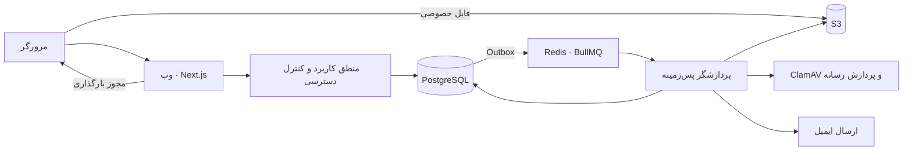

# فناوری و معماری

> راهنمای ساختار کد، تصمیم‌های فنی و توسعهٔ نیتیکت

[معرفی پروژه](README.md) · [راه‌اندازی و استقرار](DEPLOYMENT.md)

---

## پشتهٔ فنی

| بخش                | فناوری                                                    |
| ------------------ | --------------------------------------------------------- |
| اجرا و مدیریت بسته | Node.js 24، pnpm 11.5.1 و فضای کاری چندبسته‌ای            |
| رابط و سرور وب     | Next.js 16، React، TypeScript و App Router                |
| طراحی رابط         | Tailwind CSS، Radix UI، Lucide و فونت محلی وزیرمتن        |
| فرم و اعتبارسنجی   | React Hook Form و Zod                                     |
| احراز هویت         | Better Auth، Argon2id و نشست‌های پایگاه داده              |
| داده‌ها            | PostgreSQL 17 و Prisma 6                                  |
| کارهای پس‌زمینه    | Redis و BullMQ                                            |
| فایل و صدا         | S3/MinIO، ClamAV، ffmpeg، ffprobe و Sharp                 |
| پیش‌نمایش سند      | PDF.js، Mammoth و read-excel-file؛ بدون سرویس نمایش خارجی |
| آزمون و کیفیت      | Vitest، Testing Library، Playwright، ESLint و Prettier    |

نسخهٔ دقیق وابستگی‌ها در `pnpm-lock.yaml` ثبت شده است.

## نمای معماری

پروژه یک برنامهٔ یکپارچه با ماژول‌های جداست. وب و پردازشگر پس‌زمینه دو فرایند مستقل هستند و از منطق مشترک استفاده می‌کنند.



## نقشهٔ پوشه‌ها

| مسیر                               | مسئولیت                                                   |
| ---------------------------------- | --------------------------------------------------------- |
| `apps/web/src/app`                 | صفحه‌ها، مسیرهای API و لایهٔ اصلی رابط                    |
| `apps/web/src/components`          | فرم‌ها، گفتگو، مدیریت واحد، پخش صوت و پیش‌نمایش فایل      |
| `apps/worker`                      | اجرای صف، اسکن فایل و ارسال اعلان‌ها                      |
| `packages/core/src/domain`         | قواعد دسترسی و گردش وضعیت تیکت                            |
| `packages/core/src/application`    | عملیات ثبت‌نام، تیکت، مدیریت، فایل و تنظیمات              |
| `packages/core/src/infrastructure` | اتصال به هویت، پایگاه داده، صف، ذخیره‌سازی و پردازش رسانه |
| `packages/core/src/http`           | مرزبندی API، خطاها و کنترل درخواست                        |
| `packages/database/prisma`         | مدل داده، مهاجرت‌ها و محدودیت‌های پایگاه داده             |
| `infrastructure`                   | ساخت تصاویر Docker و تنظیم Nginx                          |
| `scripts`                          | آماده‌سازی محیط، مدیر اولیه و ابزارهای بررسی              |
| `tests`                            | آزمون‌های واحد، یکپارچه، مرورگر و سنجش اولیهٔ کارایی      |

## هویت و سطح دسترسی

سه نقش برنامه `STUDENT`، `STAFF` و `ADMIN` هستند. کنترل نقش و مالکیت در سرور انجام می‌شود؛ مخفی‌شدن یک دکمه جایگزین کنترل دسترسی نیست.

| عملیات                 | دانشجو            | مسئول واحد               | مدیر سامانه |
| ---------------------- | ----------------- | ------------------------ | ----------- |
| ثبت تیکت               | بله               | خیر                      | خیر         |
| مشاهدهٔ گفتگو          | تیکت خودش         | واحد مجاز خودش           | همهٔ واحدها |
| پاسخ و ارسال فایل/وویس | تیکت خودش         | واحد مجاز خودش           | خیر         |
| تغییر وضعیت            | بازگشایی طبق مهلت | انتقال‌های مجاز گردش کار | خیر         |
| یادداشت خصوصی تاریخچه  | خیر               | ایجاد و مشاهده           | مشاهده      |
| مدیریت واحد و کاربران  | خیر               | خیر                      | بله         |
| تغییر عکس مسئول        | خیر               | عکس خودش                 | عکس مسئولان |

ثبت‌نام عمومی فقط حساب دانشجو ایجاد می‌کند. دامنهٔ پیش‌فرض و تأییدشده `stu.nit.ac.ir` است. پیش از ورود با ایمیل یا شماره دانشجویی، تأیید مالکیت ایمیل الزامی است. ارقام فارسی و عربی در شناسهٔ ورود و شماره همراه به ارقام لاتین تبدیل می‌شوند.

رمزها با Argon2id ذخیره می‌شوند. نشست‌ها در پایگاه داده نگهداری و وضعیت حساب در درخواست‌ها دوباره بررسی می‌شود. تغییر اطلاعات دسترسی، نشست‌های قبلی را لغو می‌کند. عملیات حساس مدیر، ورود یا تأیید مجدد رمز در پنج دقیقهٔ اخیر می‌خواهد.

انقضای واقعی نشست، پاسخ `401` و انتقال مستقیم به صفحهٔ ورود دارد. نگهبان نشست در همهٔ پنل‌ها زمان انقضا، بازگشت به زبانه و وضعیت دوره‌ای را بررسی می‌کند. خطای شبکه باعث خروج نمی‌شود. پاسخ `REAUTH_REQUIRED` مخصوص نشست فعال است: فیلد رمز داخل همان فرم عملیات باز می‌شود و پس از تأیید، عملیات معلق یک‌بار ادامه پیدا می‌کند. رمز اشتباه با `INVALID_PASSWORD` و وضعیت `400` برمی‌گردد و کاربر از حساب خارج نمی‌شود.

مقادیر قدیمی `AGENT` و `MANAGER` در عضویت واحد برای سازگاری تاریخچه حفظ شده‌اند؛ نقش اضافه‌ای در رابط ایجاد نمی‌کنند. حساب‌های قبلی با مهاجرت حفظ شده‌اند و ثبت این تبدیل در گزارش ممیزی انجام می‌شود.

## مدل داده و سازگاری

موجودیت‌های اصلی شامل کاربر، واحد، عضویت، دسته‌بندی، تیکت، پیام، رویداد تاریخچه، یادداشت رویداد، پیوست، اعلان و گزارش ممیزی هستند. اطلاعات فایل در PostgreSQL و بایت‌های آن در S3 قرار می‌گیرند.

- ایجاد واحد و حساب مسئول در یک تراکنش انجام می‌شود؛ شناسه‌ها و نام داخلی واحد خودکارند.
- ایجاد تیکت با پیام اولیه، تاریخچه، ممیزی و رویداد اعلان یک‌جا ثبت می‌شود.
- کلید تکرارپذیری از ایجاد دوبارهٔ تیکت هنگام تلاش مجدد جلوگیری می‌کند.
- نسخهٔ تیکت جلوی بازنویسی تغییرات هم‌زمان را می‌گیرد؛ نسخهٔ قدیمی پاسخ `409` دریافت می‌کند.
- ممیزی در پایگاه داده فقط قابل افزودن است و تغییر یا حذف آن با تریگر رد می‌شود.
- پیام‌ها، تاریخچه و فهرست‌های مدیریتی صفحه‌بندی دارند. انتخاب واحد برای فرم‌ها تا ۱۰۰۰ واحد و فهرست عمومی از جستجوی نام پشتیبانی می‌کند.

## مسیر فایل و صدا

۱. سرور، نقش، مالکیت، نام، نوع و حجم فایل را بررسی و مجوز کوتاه‌مدت بارگذاری صادر می‌کند.  
۲. مرورگر فایل را مستقیم در فضای خصوصی می‌فرستد و درصد واقعی انتقال را نشان می‌دهد.  
۳. تکمیل بارگذاری، حجم واقعی را بررسی و فایل را وارد قرنطینه می‌کند.  
۴. پردازشگر، امضای فایل و ClamAV را بررسی می‌کند؛ صوت نیز رمزگشایی می‌شود.  
۵. بایت‌های تأییدشده زیر کلید تازه ذخیره می‌شوند و سپس با کنترل دسترسی قابل دریافت‌اند.

مجوز قبلی بارگذاری نمی‌تواند فایل تأییدشده را جایگزین کند. قطعی اسکنر یا پردازشگر باعث انتشار فایل بررسی‌نشده نمی‌شود.

مدت وویس از نمونه‌های صوتی رمزگشایی‌شده محاسبه می‌شود؛ بنابراین WebM ضبط‌شده در مرورگر بدون مشخصات مدت نیز پشتیبانی می‌شود. شکل موج از ۸۰ بازهٔ شدت واقعی صدا تولید می‌شود. عکس مسئول با محدودیت تعداد پیکسل بررسی، حداکثر تا ۵۱۲×۵۱۲ کوچک و به WebP بدون فرادادهٔ اصلی تبدیل می‌شود.

پیش‌نمایش‌ها محلی‌اند: PDF با worker و دارایی‌های محلی، DOCX به‌صورت متن امن، XLSX تا ۵۰۰ ردیف و ۳۰ ستون از برگهٔ اول و متن تا ۳۰۰ هزار نویسه. پیش‌نمایش اسناد تا ۲۰ مگابایت انجام می‌شود؛ دریافت فایل اصلی جداست. دریافت رسانه فعلاً بایت‌های محدود را در حافظه نگه می‌دارد و HTTP Range ندارد.

سیاست CSP از nonce، محدودیت منبع فایل و worker استفاده می‌کند. اجازهٔ WebAssembly برای رمزگشاهای PDF فعال است؛ طبق [استاندارد CSP](https://www.w3.org/TR/CSP/)، این مجوز اجرای `eval` جاوااسکریپت را فعال نمی‌کند.

## API و پردازش پس‌زمینه

پاسخ API معمولاً `{ data, requestId }` و خطا `{ error, requestId }` است. تغییرات نیازمند نشست معتبر، Origin برابر دامنهٔ سامانه و اعتبارسنجی ورودی هستند.

| مسیر                                               | کاربرد                                          |
| -------------------------------------------------- | ----------------------------------------------- |
| `/api/register`                                    | ثبت‌نام دانشجو و ارسال تأیید ایمیل              |
| `/api/auth/*`                                      | مسیرهای مجاز ورود، خروج، تأیید ایمیل و رمز عبور |
| `/api/v1/tickets`                                  | فهرست و ثبت درخواست دانشجو                      |
| `/api/v1/tickets/:id`                              | گفتگو و تاریخچه طبق نقش                         |
| `/api/v1/tickets/:id/activities/:activityId/notes` | یادداشت اختیاری مسئول برای رویداد               |
| `/api/v1/uploads/*` و `/api/v1/attachments/*`      | بارگذاری، وضعیت اسکن و دریافت مجاز              |
| `/api/v1/avatars/*`                                | تصویر پروفایل مسئول                             |
| `/api/v1/admin/*`                                  | واحدها، کاربران، تنظیمات و عملیات مدیر          |
| `/api/health/live` و `/api/health/ready`           | سلامت فرایند و اتصال پایگاه داده/Redis          |

Outbox در PostgreSQL منبع پایدار کارهای پس‌زمینه است و Redis حمل صف را انجام می‌دهد. اعلان‌ها با کلید یکتا تکرار نمی‌شوند. خطای ارسال ایمیل با زمان‌بندی افزایشی ذخیره و دوباره امتحان می‌شود؛ تحویل SMTP تضمین دقیقاً یک‌بار ندارد. اعلان خوانده‌نشده در پنل به‌صورت دوره‌ای تازه می‌شود.

## توسعه، قالب‌بندی و آزمون

```sh
pnpm format
pnpm format:check
pnpm typecheck
pnpm lint
pnpm test
pnpm test:integration
pnpm build
pnpm test:e2e
pnpm audit --prod --audit-level=high
```

Prettier قالب فایل‌های TypeScript، React، CSS، JSON، YAML و مستندات را یکسان می‌کند. ESLint فاصلهٔ بخش‌های import، توابع و exportها را کنترل می‌کند. `pnpm format` مدل Prisma را هم مرتب می‌کند. فایل‌های SQL مهاجرت اجراشده بازنویسی نمی‌شوند تا checksum و تاریخچهٔ استقرار تغییر نکند. فایل‌های تولیدشده و وابستگی‌ها وارد قالب‌بندی نمی‌شوند.

آزمون یکپارچه به PostgreSQL، Redis، MinIO، ClamAV و Mailpit واقعی نیاز دارد. پایگاه آزمون باید نامی با پایان `_test` داشته باشد. آزمون مرورگر روی درگاه ۳۰۰۱ اجرا می‌شود و برای بررسی صوت از worker واقعی Docker استفاده می‌کند. دستورهای آماده‌سازی در [راهنمای استقرار](DEPLOYMENT.md) آمده‌اند.

آزمون‌ها دسترسی نقش‌ها، ثبت‌نام و ایمیل، تراکنش‌ها، نسخهٔ هم‌زمان، فایل خصوصی، اسکن، وویس مرورگر، پیش‌نمایش، پروفایل، تنظیمات و نمایش موبایل را پوشش می‌دهند. بررسی روی میکروفون و دستگاه‌های فیزیکی و آزمون بار گسترده همچنان باید در محیط مقصد انجام شود. SSO، MFA، تقویم SLA، نگهداری خودکار داده و استقرار با دسترس‌پذیری بالا در نسخهٔ فعلی پیاده‌سازی نشده‌اند.
