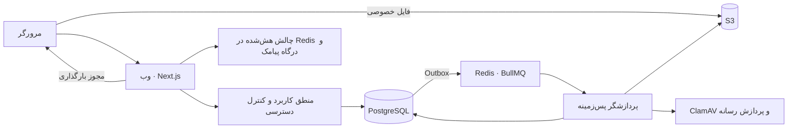

# فناوری و معماری

> راهنمای ساختار کد، تصمیم‌های فنی و توسعهٔ نیتیکت

[معرفی پروژه](README.md) · [راه‌اندازی و استقرار](DEPLOYMENT.md)

---

## پشتهٔ فنی

| بخش                | فناوری                                                    |
| ------------------ | --------------------------------------------------------- |
| اجرا و مدیریت بسته | Bun 1.4.4 و فضای کاری چندبسته‌ای                          |
| رابط و سرور وب     | Next.js 16، React، TypeScript و App Router                |
| طراحی رابط         | Tailwind CSS، Radix UI، Lucide و فونت محلی وزیرمتن        |
| فرم و اعتبارسنجی   | فرم‌های React و Zod                                       |
| احراز هویت         | Better Auth، Argon2id و نشست‌های پایگاه داده              |
| داده‌ها            | PostgreSQL 17 و Prisma 6                                  |
| کارهای پس‌زمینه    | Redis و BullMQ                                            |
| فایل و صدا         | S3/MinIO، ClamAV، ffmpeg، ffprobe و Sharp                 |
| پیش‌نمایش سند      | PDF.js، Mammoth و read-excel-file؛ بدون سرویس نمایش خارجی |
| آزمون و کیفیت      | Vitest، Testing Library، Playwright، ESLint و Prettier    |

نسخهٔ دقیق وابستگی‌ها در `bun.lock` ثبت شده است. نسخهٔ Bun در `.bun-version`، `packageManager` و تصویر Docker یکسان و ثابت است. نصب CI و Docker با `--frozen-lockfile` انجام می‌شود؛ ساختار workspaceها و override امنیتی `deepmerge-ts` در `package.json` قرار دارند. فقط وابستگی‌های مشخص‌شده در `trustedDependencies` اجازهٔ اجرای اسکریپت نصب دارند.

وب Next.js، worker، ابزارهای Prisma و TypeScript و آزمون‌ها با runtime خود Bun اجرا می‌شوند. تنظیم `run.bun` و فرمان‌های `bun --bun` از برگشت ناخواستهٔ CLIها به Node جلوگیری می‌کنند. importهای استاندارد `node:*` و `@types/node` برای APIهای سازگار باقی مانده‌اند؛ نصب Node یا pnpm لازم نیست. در Vitest، Zod به‌صورت inline پردازش می‌شود تا مشکل شناخته‌شدهٔ interop در Bun 1.4.4 روی اعتبارسنجی‌ها اثر نگذارد؛ کد اعتبارسنجی production تغییری نکرده است.

## نمای معماری

پروژه یک برنامهٔ یکپارچه با ماژول‌های جداست. وب و پردازشگر پس‌زمینه دو فرایند مستقل هستند و از منطق مشترک استفاده می‌کنند.



## نقشهٔ پوشه‌ها

| مسیر                               | مسئولیت                                                   |
| ---------------------------------- | --------------------------------------------------------- |
| `apps/web/src/app`                 | صفحه‌ها، مسیرهای API و لایهٔ اصلی رابط                    |
| `apps/web/src/components`          | فرم‌ها، گفتگو، مدیریت واحد، پخش صوت و پیش‌نمایش فایل      |
| `apps/worker`                      | اجرای صف، اسکن فایل و ارسال اعلان‌ها                      |
| `packages/core/src/domain`         | قواعد دسترسی و گردش وضعیت تیکت                            |
| `packages/core/src/application`    | عملیات ثبت‌نام، تیکت، مدیریت، فایل و تنظیمات              |
| `packages/core/src/infrastructure` | اتصال به هویت، پایگاه داده، صف، ذخیره‌سازی و پردازش رسانه |
| `packages/core/src/http`           | مرزبندی API، خطاها و کنترل درخواست                        |
| `packages/database/prisma`         | مدل داده، مهاجرت‌ها و محدودیت‌های پایگاه داده             |
| `infrastructure`                   | ساخت تصاویر Docker و تنظیم Nginx                          |
| `scripts`                          | آماده‌سازی محیط، مدیر اولیه و ابزارهای بررسی              |
| `tests`                            | آزمون‌های واحد، یکپارچه، مرورگر و سنجش اولیهٔ کارایی      |

## هویت و سطح دسترسی

سه نقش برنامه `STUDENT`، `STAFF` و `ADMIN` هستند. کنترل نقش و مالکیت در سرور انجام می‌شود؛ مخفی‌شدن یک دکمه جایگزین کنترل دسترسی نیست.

| عملیات                 | دانشجو              | مسئول واحد           | مدیر سامانه |
| ---------------------- | ------------------- | -------------------- | ----------- |
| ثبت تیکت               | بله                 | خیر                  | خیر         |
| مشاهدهٔ گفتگو          | تیکت خودش           | واحد مجاز خودش       | همهٔ واحدها |
| پاسخ و ارسال فایل/وویس | تیکت خودش           | واحد مجاز خودش       | خیر         |
| دسته‌بندی گفتگو        | خودکار با پیام جدید | خودکار با پاسخ عمومی | فقط مشاهده  |
| یادداشت خصوصی تاریخچه  | خیر                 | ایجاد و مشاهده       | مشاهده      |
| مدیریت واحد و کاربران  | خیر                 | خیر                  | بله         |
| تغییر عکس مسئول        | خیر                 | عکس خودش             | عکس مسئولان |

ثبت‌نام عمومی پس از تأیید شماره موبایل با OTP، فقط حساب دانشجو ایجاد می‌کند. ارقام فارسی و عربی و قالب‌های محلی شماره به شناسهٔ یکتای بین‌المللی تبدیل می‌شوند. مسئولان توسط مدیر به واحد تخصیص می‌یابند.

رمزها با Argon2id ذخیره می‌شوند. نشست‌ها در پایگاه داده نگهداری و وضعیت حساب در درخواست‌ها دوباره بررسی می‌شود. تغییر اطلاعات دسترسی، نشست‌های قبلی را لغو می‌کند. عملیات حساس مدیر، ورود یا تأیید مجدد هویت با رمز یا کد موبایل در پنج دقیقهٔ اخیر می‌خواهد.

انقضای واقعی نشست، پاسخ `401` و انتقال مستقیم به صفحهٔ ورود دارد. نگهبان نشست در همهٔ پنل‌ها زمان انقضا، بازگشت به زبانه و وضعیت دوره‌ای را بررسی می‌کند. خطای شبکه باعث خروج نمی‌شود. پاسخ `REAUTH_REQUIRED` مخصوص نشست فعال است: بخش تأیید با کد موبایل یا رمز داخل همان فرم عملیات باز می‌شود و پس از تأیید، عملیات معلق یک‌بار ادامه پیدا می‌کند. رمز اشتباه با `INVALID_PASSWORD` و وضعیت `400` برمی‌گردد و کاربر از حساب خارج نمی‌شود.

مقادیر قدیمی `AGENT` و `MANAGER` در عضویت واحد برای سازگاری تاریخچه حفظ شده‌اند؛ نقش اضافه‌ای در رابط ایجاد نمی‌کنند. حساب‌های قبلی با مهاجرت حفظ شده‌اند و ثبت این تبدیل در گزارش ممیزی انجام می‌شود.

## مدل داده و سازگاری

موجودیت‌های اصلی شامل کاربر، واحد، عضویت، دسته‌بندی، تیکت، پیام، رویداد تاریخچه، یادداشت رویداد، پیوست، اعلان و گزارش ممیزی هستند. اطلاعات فایل در PostgreSQL و بایت‌های آن در S3 قرار می‌گیرند.

- ایجاد واحد و حساب مسئول در یک تراکنش انجام می‌شود؛ شناسه‌ها و نام داخلی واحد خودکارند.
- رابط جدید با `POST /api/v1/conversations` گفتگوی واحد را باز یا ایجاد می‌کند؛ بازکردن هم‌زمان تحت تراکنش Serializable به همان گفتگو برمی‌گردد. عنوان و پیام اولیه لازم نیست و اعلان با اولین پیام عمومی ایجاد می‌شود.
- پیام عمومی دانشجو وضعیت داخلی را `OPEN` و پاسخ عمومی مسئول آن را `WAITING_FOR_USER` می‌کند. گفتگوهای قدیمی بسته‌شده نیز قابل ادامه‌اند؛ مقادیر تاریخی وضعیت برای سازگاری داده و گزارش حفظ شده‌اند. بستن یا پایان‌دادن جدید از سرویس رد می‌شود.
- کلید تکرارپذیری از ایجاد دوبارهٔ تیکت هنگام تلاش مجدد جلوگیری می‌کند.
- پیام‌ها از `clientId` اختیاری برای جلوگیری از تکرار هنگام ارسال مجدد استفاده می‌کنند. پیام تکراری با همان محتوا و نویسنده دوباره ثبت یا اعلان نمی‌شود.
- نسخهٔ تیکت جلوی بازنویسی تغییرات هم‌زمان را می‌گیرد؛ نسخهٔ قدیمی پاسخ `409` دریافت می‌کند.
- ممیزی در پایگاه داده فقط قابل افزودن است و تغییر یا حذف آن با تریگر رد می‌شود.
- پیام‌ها، تاریخچه و فهرست‌های مدیریتی صفحه‌بندی دارند. انتخاب واحد برای فرم‌ها تا ۱۰۰۰ واحد و فهرست عمومی از جستجوی نام پشتیبانی می‌کند.

## مسیر فایل و صدا

۱. سرور، نقش، مالکیت، نام، نوع و حجم فایل را بررسی و مجوز کوتاه‌مدت بارگذاری صادر می‌کند.  
۲. مرورگر فایل را مستقیم در فضای خصوصی می‌فرستد و درصد واقعی انتقال را نشان می‌دهد.  
۳. تکمیل بارگذاری، حجم واقعی را بررسی و فایل را وارد قرنطینه می‌کند.  
۴. پردازشگر، امضای فایل و ClamAV را بررسی می‌کند؛ صوت نیز رمزگشایی می‌شود.  
۵. بایت‌های تأییدشده زیر کلید تازه ذخیره می‌شوند و سپس با کنترل دسترسی قابل دریافت‌اند.

مجوز قبلی بارگذاری نمی‌تواند فایل تأییدشده را جایگزین کند. قطعی اسکنر یا پردازشگر باعث انتشار فایل بررسی‌نشده نمی‌شود.

مدت وویس از نمونه‌های صوتی رمزگشایی‌شده محاسبه می‌شود؛ بنابراین WebM ضبط‌شده در مرورگر بدون مشخصات مدت نیز پشتیبانی می‌شود. شکل موج از ۸۰ بازهٔ شدت واقعی صدا تولید می‌شود. عکس مسئول با محدودیت تعداد پیکسل بررسی، حداکثر تا ۵۱۲×۵۱۲ کوچک و به WebP بدون فرادادهٔ اصلی تبدیل می‌شود.

پیش‌نمایش‌ها محلی‌اند: PDF با worker و دارایی‌های محلی، DOCX به‌صورت متن امن، XLSX تا ۵۰۰ ردیف و ۳۰ ستون از برگهٔ اول و متن تا ۳۰۰ هزار نویسه. پیش‌نمایش اسناد تا ۲۰ مگابایت انجام می‌شود؛ دریافت فایل اصلی جداست. مسیر HTTP فایل، بایت‌ها را با backpressure و امکان لغو از S3 به مرورگر جریان می‌دهد و طول دقیق پاسخ را اعلام می‌کند؛ HTTP Range ندارد. خواندن داخلی اسکنر و آواتار همچنان با بافر محدود انجام می‌شود.

سیاست CSP از nonce، محدودیت منبع فایل و worker استفاده می‌کند. اجازهٔ WebAssembly برای رمزگشاهای PDF فعال است؛ طبق [استاندارد CSP](https://www.w3.org/TR/CSP/)، این مجوز اجرای `eval` جاوااسکریپت را فعال نمی‌کند.

## API و پردازش پس‌زمینه

پاسخ API معمولاً `{ data, requestId }` و خطا `{ error, requestId }` است. تغییرات نیازمند نشست معتبر، Origin برابر دامنهٔ سامانه و اعتبارسنجی ورودی هستند.

| مسیر                                               | کاربرد                                             |
| -------------------------------------------------- | -------------------------------------------------- |
| `/api/register`                                    | مسیر قدیمی؛ پاسخ ۴۱۰ و هدایت به ورود موبایلی       |
| `/api/auth/*`                                      | مسیرهای مجاز ورود موبایلی، OTP، خروج و رمز عبور    |
| `/api/v1/tickets`                                  | فهرست و ثبت درخواست دانشجو                         |
| `/api/v1/conversations`                            | بازکردن مستقیم یا ادامه گفتگوی واحد بدون فرم عنوان |
| `/api/v1/tickets/:id`                              | گفتگو و تاریخچه طبق نقش                            |
| `/api/v1/tickets/:id/activities/:activityId/notes` | یادداشت اختیاری مسئول برای رویداد                  |
| `/api/v1/uploads/*` و `/api/v1/attachments/*`      | بارگذاری، وضعیت اسکن و دریافت مجاز                 |
| `/api/v1/avatars/*`                                | تصویر پروفایل مسئول                                |
| `/api/v1/admin/*`                                  | واحدها، کاربران، تنظیمات و عملیات مدیر             |
| `/api/health/live` و `/api/health/ready`           | سلامت فرایند و اتصال پایگاه داده/Redis             |

Outbox در PostgreSQL منبع پایدار کارهای پس‌زمینه است و Redis حمل صف را انجام می‌دهد. اعلان‌ها با کلید یکتا تکرار نمی‌شوند. مسیر تحویل ایمیل حذف شده است؛ اعلان‌ها فقط داخل سامانه ثبت می‌شوند. اعلان خوانده‌نشده در پنل به‌صورت دوره‌ای تازه می‌شود.

## توسعه، قالب‌بندی و آزمون

```sh
docker compose build tools
docker compose run --rm tools bun run format:check
docker compose run --rm tools bun run typecheck
docker compose run --rm tools bun run lint
docker compose run --rm tools bun run test
docker compose run --rm tools bun run test:integration
docker compose build web worker
docker compose run --rm tools bun audit --prod --audit-level=high
```

Prettier قالب فایل‌های TypeScript، React، CSS، JSON، YAML و مستندات را یکسان می‌کند. ESLint فاصلهٔ بخش‌های import، توابع و exportها را کنترل می‌کند. `bun run format` مدل Prisma را هم مرتب می‌کند. فایل‌های SQL مهاجرت اجراشده بازنویسی نمی‌شوند تا checksum و تاریخچهٔ استقرار تغییر نکند. فایل‌های تولیدشده و وابستگی‌ها وارد قالب‌بندی نمی‌شوند.

آزمون یکپارچه به PostgreSQL، Redis، MinIO و ClamAV واقعی نیاز دارد. پایگاه آزمون باید نامی با پایان `_test` داشته باشد. سرویس `tools` از پروفایل اختیاری استفاده می‌کند و وابستگی‌ها و خروجی بررسی‌ها را داخل کانتینر نگه می‌دارد؛ کد تست‌ها در مخزن حفظ می‌شود. آزمون‌های مرورگر در CI با Playwright روی درگاه ۳۰۰۱ اجرا می‌شوند و برای بررسی صوت از worker واقعی Docker استفاده می‌کنند. دستورهای آماده‌سازی در [راهنمای استقرار](DEPLOYMENT.md) آمده‌اند.

آزمون‌ها دسترسی نقش‌ها، ورود موبایلی و OTP، تراکنش‌ها، نسخهٔ هم‌زمان، فایل خصوصی، اسکن، وویس مرورگر، پیش‌نمایش، پروفایل، تنظیمات و نمایش موبایل را پوشش می‌دهند. بررسی روی میکروفون و دستگاه‌های فیزیکی و آزمون بار گسترده همچنان باید در محیط مقصد انجام شود. SSO، MFA، تقویم SLA، نگهداری خودکار داده و استقرار با دسترس‌پذیری بالا در نسخهٔ فعلی پیاده‌سازی نشده‌اند.

## هویت موبایلی و نشست

Compose شمارهٔ `ADMIN_PHONE` را صریحاً به وب می‌دهد و `SYNC_ROOT_ADMIN_ON_STARTUP=true` را فعال می‌کند. تابع `register` در instrumentation نود، پیش از پذیرش درخواست، مدیر را با تراکنش Serializable و advisory lock همگام می‌کند. وضعیت مدیر در کلید خصوصی `root-administrator` نگهداری می‌شود. شمارهٔ جدید حساب مستقل خودش را دارد؛ حساب موجود با همان شماره حفظ و حساب قبلی مدیر تنزل نقش می‌یابد. نشست‌ها و رمزهای درگیر در انتقال لغو می‌شوند؛ شمارهٔ تازه تا اثبات OTP ورود ندارد. همگام‌سازی با همان شماره idempotent است و نشست و رمز معتبر را دست‌کاری نمی‌کند. فرایند قدیمی با تنظیم متفاوت نیز نمی‌تواند با OTP، مدیر قبلی را دوباره ارتقا دهد. `scripts/bootstrap.ts` همین عملیات را برای اجرای خارج از Compose انجام می‌دهد. این رفتار بر مبنای [instrumentation در Next.js](https://nextjs.org/docs/app/api-reference/file-conventions/instrumentation) و [بازسازی کانتینر با Compose up](https://docs.docker.com/reference/cli/docker/compose/up/) است.

همهٔ شماره‌ها با پشتیبانی ارقام فارسی و عربی به `+989xxxxxxxxx` تبدیل می‌شوند و `User.phoneNumber` قید یکتا دارد. ثبت‌نام فقط پس از اثبات مالکیت شماره با OTP انجام می‌شود. ایمیل داخلی تصادفی با دامنهٔ نامعتبر صرفاً برای قرارداد داخلی Better Auth نگهداری می‌شود؛ مسیرهای HTTP ایمیل، نام کاربری و بازیابی ایمیلی بسته‌اند و پاسخ عمومی هویت فاقد ایمیل و توکن نشست است.

چالش OTP با HMAC در Redis، انقضای پنج دقیقه، وقفهٔ ارسال ۶۰ ثانیه، سقف پنج حدس و سهمیهٔ ارسال پنج کد در ۱۵ دقیقه و ۲۰ کد در روز نگهداری می‌شود. صدور و مصرف با Lua اتمی‌اند. کد تأیید عملیات حساس به همان نشست و هدف متصل است. محدودیت IP و شماره در Redis میان همهٔ نمونه‌های وب مشترک است. پیاده‌سازی درگاه پیامک در `sms.ts` جداست و فعلاً کد فقط در لاگ توسعه ثبت می‌شود.

نشست HttpOnly و SameSite=Lax است؛ در HTTPS ویژگی Secure نیز دارد. مدت پیش‌فرض ۳۰ روز و تمدید روزانه است. مرورگر از `get-session` کوکی تازه دریافت می‌کند؛ خواندن نشست در سرور بدون تمدید انجام می‌شود. بازیابی نقش به‌ازای هر درخواست انجام می‌شود و فقط در همان رندر React تکرارزدایی می‌شود. عملیات حساس پس از پنج دقیقه به تأیید دوباره با رمز یا OTP نیاز دارد. رمز اختیاری با Argon2id نگهداری می‌شود؛ تعیین یا تغییر آن سایر نشست‌ها را لغو می‌کند.

حساب کاربری، نشست جاری و سایر نشست‌های فعال را در صفحات ۲۰تایی نشان می‌دهد. نوع دستگاه، سیستم‌عامل و مرورگر از User-Agent صرفاً برای نمایش تشخیص داده می‌شوند و مبنای اعتماد یا مجوز نیستند. زمان ورود از `createdAt` و آخرین فعالیت از `lastSeenAt` خوانده می‌شود؛ ثبت فعالیت حداکثر هر پنج دقیقه انجام می‌شود و به `updatedAt` و زمان تمدید Better Auth دست نمی‌زند. توکن، IP و User-Agent خام در پاسخ فهرست نشست‌ها برنمی‌گردند.

مسیر `GET /api/v1/users/me/sessions` فقط نشست‌های فعال همان کاربر را برمی‌گرداند. حذف نشست مشخص یا همهٔ نشست‌های دیگر با `DELETE`، کنترل مالکیت و تأیید هویت تازه انجام می‌شود و ممیزی دارد. نشست جاری هنگام خروج سایر دستگاه‌ها حفظ می‌شود؛ خروج از همین دستگاه از مسیر رسمی خروج و پاک‌کردن کوکی استفاده می‌کند. لغو نشست با حذف رکورد سرور، دسترسی درخواست بعدی آن دستگاه را قطع می‌کند.

چت در حالت بدون تغییر، فقط نسخه و زمان تغییر را بررسی می‌کند؛ تاریخچه دوباره ارسال نمی‌شود. صندوق نیز قبل از رندر مجدد، نسخهٔ خلاصهٔ گفتگوهای مجاز را بررسی می‌کند. شمار اعلان‌ها از endpoint سبک جدا خوانده می‌شود. بررسی دسترسی در تمام این مسیرها برقرار است.

## بارگذاری تدریجی و رندر چت

صفحهٔ گفتگو یک loading boundary مستقل دارد. اطلاعات اولیه فقط ۵۰ پیام آخر و پیوست‌های همان صفحه را می‌خواند؛ تاریخچه و یادداشت‌ها هنگام باز شدن بخش مربوط از API جدا دریافت می‌شوند. صفحه‌بندی پیام‌ها از `GET /api/v1/tickets/:id/messages?cursor=...` استفاده می‌کند تا همراه هر صفحه، جزئیات و تاریخچهٔ تکراری ارسال نشود. اعتبارسنجی cursor و مجوز گفتگو در هر درخواست بررسی می‌شود.

فهرست پیام‌ها با React Virtuoso رندر مجازی دارد؛ فقط محدودهٔ دید و حاشیهٔ کوتاهی از آن در DOM باقی می‌ماند. جای پیام قابل مشاهده هنگام افزودن پیام‌های قدیمی حفظ می‌شود. ردیف‌های پیام memo هستند و با تغییر متن پیش‌نویس دوباره ساخته نمی‌شوند. قالب‌بندهای تاریخ و عدد نیز میان رندرها بازاستفاده می‌شوند. مستند رفتار فهرست در [مرجع رسمی Virtuoso](https://virtuoso.dev/react-virtuoso/api-reference/virtuoso/) آمده است.

دنبال‌کردن خودکار انتهای چت فقط وقتی فعال است که کاربر در انتهای گفتگو باشد. چرخش رو به بالای ماوس، کلیدهای حرکت به بالا و خروج از محدودهٔ انتهایی آن را صریحاً غیرفعال می‌کنند تا اندازه‌گیری دیرهنگام ردیف‌های تازه، کاربر را به پایین برنگرداند. رسیدن دوباره به انتهای گفتگو آن را فعال می‌کند. تست بازیابی پیام‌های جامانده، حرکت واقعی چرخ ماوس بلافاصله پس از دریافت دستهٔ جدید و حفظ موقعیت پیام را بررسی می‌کند.

وویس تا لمس دکمهٔ پخش درخواست شبکه نمی‌فرستد. یک پخش‌کنندهٔ مشترک خارج از ردیف‌های مجازی، پخش را هنگام اسکرول ادامه می‌دهد و کنترل کوچک بالای گفتگو در دسترس می‌ماند؛ خروج از گفتگو صدا را متوقف می‌کند. تصاویر با lazy loading و ابعاد رزروشده بارگذاری می‌شوند و پردازش سند همچنان فقط پس از درخواست پیش‌نمایش انجام می‌شود.

در دسکتاپ، نوار اصلی پایین صفحه قرار دارد. صندوق از عرض بیشتری استفاده می‌کند، انتخاب واحدها و فرم حساب روی نمایشگر بزرگ چندستونه‌اند و روی موبایل تک‌ستونه باقی می‌مانند. ورودی شماره، قالب‌های محلی، بدون صفر و `+98` را در رابط و سرور به یک هویت تبدیل می‌کند؛ شماره و OTP هر دو `inputMode=numeric` دارند.

آزمون مرورگر با ۲۰۰۰ پیام، محدود بودن تعداد ردیف‌های DOM، صفحه‌بندی، حفظ پیش‌نویس، تعویق دانلود صوت و ادامهٔ پخش هنگام اسکرول را بررسی می‌کند. آزمون دیگر جای نوار دسکتاپ و پذیرش قالب‌های مختلف موبایل و ارقام فارسی OTP را می‌سنجد. نصب وابستگی Docker نیز از کش پایدار BuildKit استفاده می‌کند تا تغییر lockfile موجب دانلود دوبارهٔ همهٔ بسته‌ها در ساخت‌های بعدی نشود.

فهرست کاربران مدیر با cursor مبتنی بر شناسه در صفحات ۳۰تایی و هر دو جهت حرکت می‌کند؛ `COUNT` و صفحه‌بندی offset ندارد. شماره موبایل و آخرین ورود در ردیف کاربر دیده می‌شود. جستجوی شمارهٔ کامل از شناسهٔ استاندارد و ایندکس شماره استفاده می‌کند؛ قالب‌های محلی، بین‌المللی و ارقام فارسی پذیرفته می‌شوند و شماره‌های قدیمی نیز قابل جستجو هستند.

انتخابگر واحد در صندوق، گزارش و شروع گفتگو فقط اطلاعات لازم را می‌خواند؛ دسته‌بندی‌ها و عضویت‌های واحد برای این انتخابگرها ارسال نمی‌شوند. صفحهٔ شروع گفتگو، واحدها را از `/api/v1/departments/choices` با cursor در صفحات ۵۰تایی می‌خواند؛ جستجوی نام و توضیح سمت سرور است و سقف قدیمی ۱۰۰۰ واحد مانع یافتن واحدهای بعدی نمی‌شود. جستجو ۲۵۰ میلی‌ثانیه وقفه دارد و درخواست قبلی لغو می‌شود؛ هر صفحه جایگزین صفحهٔ قبلی می‌شود تا DOM بزرگ نشود. لینک مستقیم واحد نیز مستقل از صفحهٔ اول و با کنترل دسترسی باز می‌شود. درخواست‌های شمارش اعلان هم‌زمان اجرا نمی‌شوند و دریافت‌های اعلان و صندوق هنگام خروج از صفحه لغو می‌شوند. دنبال‌کردن لینک اعلان، رندر دوبارهٔ غیرضروری صفحهٔ مقصد را ایجاد نمی‌کند.

پیش‌نمایش PDF در طول باز بودن پنجره، فایل و سند پردازش‌شده را بازاستفاده می‌کند؛ تعویض صفحه فقط رندر همان صفحه را انجام می‌دهد. worker هنگام بسته‌شدن آزاد و رندر قبلی هنگام تعویض صفحه لغو می‌شود. سقف ۲۰ مگابایت پیش از دریافت و هنگام خواندن جریان فایل بررسی می‌شود. آزمون مرورگر، یک‌بار دریافت PDF در تعویض صفحات، لغو واقعی نشست‌ها، تأیید هویت مجدد و حرکت بین صفحات کاربران را پوشش می‌دهد.

## جستجوی پیام‌ها

صفحهٔ `/search` از نوار بالا و جستجوی صندوق در دسترس است؛ دکمهٔ ذره‌بین داخل گفتگو و میان‌بر `Ctrl/Cmd+F` جستجو را به همان گفتگو محدود می‌کنند. جستجو روی تمام پیام‌های ذخیره‌شده انجام می‌شود و به صفحه‌های دریافت‌شده در مرورگر وابسته نیست. فیلترهای متن، فایل، عکس، صدا، لینک، فرستنده، تاریخ، ترتیب زمانی و پیام عمومی/خصوصی وجود دارند. جستجوی همهٔ واژه‌ها، یکی از واژه‌ها، عبارت دقیق در کوتیشن و حذف واژه با پیشوند `-` پشتیبانی می‌شود. محتوای صوت یا اسناد به متن تبدیل نمی‌شود؛ فایل‌ها از روی نام و نوع تأییدشده جستجو می‌شوند.

`GET /api/v1/search` حداکثر ۲۰ نتیجه و پنج نام فایل برای هر نتیجه برمی‌گرداند؛ نام فایل مطابق عبارت در اولویت نمایش است. خروجی شامل چکیده و بخش‌های قابل برجسته‌کردن است و HTML ساخته‌شده از پیام ندارد. `GET /api/v1/search/senders` فقط فرستنده‌های دارای پیام قابل‌مشاهده را در صفحات ۲۰تایی نشان می‌دهد. کنترل دسترسی گفتگو و عمومی/خصوصی بودن پیام در SQL اعمال می‌شود؛ نام فایل قرنطینه‌شده، یادداشت تاریخچه و آواتار وارد جستجوی پیام نمی‌شود. پاسخ‌ها خصوصی و بدون کش مرورگرند و متن جستجو در لاگ API ثبت نمی‌شود.

مهاجرت جستجو افزونهٔ استاندارد PostgreSQL به نام `pg_trgm` را فعال می‌کند. تابع immutable به نام `niticket_search_text`، حروف عربی/فارسی، ارقام، فاصله و نیم‌فاصله و اعراب را یکسان می‌کند؛ متن اصلی دست‌نخورده می‌ماند. ایندکس‌های GIN روی عبارت نرمال‌شدهٔ بدنه و نام فایل تأییدشده و ایندکس‌های مرتب‌سازی تاریخ/شناسه، از جستجوی زیررشته و صفحه‌بندی پشتیبانی می‌کنند. مبنا، [مستند رسمی pg_trgm در PostgreSQL 17](https://www.postgresql.org/docs/17/pgtrgm.html) و [ایندکس عبارت](https://www.postgresql.org/docs/17/indexes-expressional.html) است. داده به موتور جستجوی بیرونی ارسال نمی‌شود.

صفحه‌بندی نتایج keyset است؛ `OFFSET` یا شمارش همهٔ نتایج ندارد. cursor با HMAC به کاربر، دامنهٔ مجوز، فیلترها، ترتیب و زمان snapshot متصل می‌شود و یک ساعت اعتبار دارد؛ پیام‌های تازه میان صفحات snapshot وارد نمی‌شوند. همهٔ مقادیر SQL پارامتری و علامت‌های LIKE به‌صورت لفظی escape می‌شوند. عبارت حداکثر ۲۰۰ نویسه و هشت واژه دارد. درخواست‌های جستجو ۹۰ بار در دقیقه برای هر کاربر محدود می‌شوند و هر پرس‌وجوی جستجو سقف اجرای ۲٫۵ ثانیه دارد. درخواست مرورگر با وقفهٔ ۳۰۰ میلی‌ثانیه صادر و هنگام تغییر عبارت یا خروج لغو می‌شود؛ DOM فقط یک صفحهٔ نتیجه را نگه می‌دارد.

برای عبارت تک‌واژه‌ای، شاخهٔ متن و نام فایل هر کدام پیش از ادغام به ۲۱ پیام مرتب‌شده محدود می‌شوند تا واژهٔ پرتکرار به ساختن فهرست کامل نتایج نیاز نداشته باشد؛ موارد تکراری پس از ادغام حذف می‌شوند. جستجوی چندواژه‌ای داخل گفتگو، مجموعه‌های میانی را نیز به همان گفتگو محدود می‌کند. فقط داخل تراکنش جستجو، `plan_cache_mode=force_custom_plan` فعال است تا تغییر انتخاب‌پذیری عبارت‌ها باعث استفادهٔ نامناسب از طرح عمومی prepared statement نشود؛ سایر پرس‌وجوهای برنامه تغییر نمی‌کنند. مبنای این تنظیم، [راهنمای برنامه‌ریزی پرس‌وجوی PostgreSQL](https://www.postgresql.org/docs/17/runtime-config-query.html) است.

انتخاب نتیجه از `GET /api/v1/tickets/:id/messages/context?messageId=...` برای دریافت حداکثر ۵۰ پیام اطراف آن استفاده می‌کند. مسیر پیام‌ها در جهت `older` و `newer` صفحه‌بندی می‌شود؛ مجوز پیام انتخاب‌شده و همسایه‌ها دوباره بررسی می‌شود. لینک مستقیم نیز در رندر سرور فقط پنجرهٔ همان پیام را می‌خواند. هنگام دیدن نتیجه، همگام‌سازی زنده پیام‌های آخر را به وسط تاریخچه نمی‌چسباند؛ کاربر می‌تواند به آخرین پیام‌ها برگردد. پیش‌نویس و فایل‌های انتخاب‌شده هنگام جستجوی داخل گفتگو حفظ می‌شوند و حرکت بین نتیجه‌های قبلی/بعدی از مرز صفحه هم عبور می‌کند.

آزمون‌ها تطابق نرمال‌سازی JavaScript و PostgreSQL، استفاده از ایندکس، متن و فایل، بازهٔ روز با منطقهٔ تهران، صفحه‌بندی با زمان‌های برابر، cursor دست‌کاری‌شده، پیام خصوصی و دسترسی لغوشده را پوشش می‌دهند. مرورگر، جستجو در چت ۲۰۰۰پیامی، پرش مستقیم، حفظ پیش‌نویس، حرکت میان صفحات نتایج، نمایش موبایل و نبود دانلود پیوست هنگام جستجو را بررسی می‌کند.

## دریافت فایل و ارسال پیام

دانلود کاربر از مسیر مجاز پیوست، به‌صورت جریان با `Content-Length` دقیق و `Cache-Control: private, no-store, no-transform` انجام می‌شود. نوع، طول نهایی و سقف ۵۰ مگابایت کنترل و لغو مرورگر تا S3 منتقل می‌شود. پاسخ کامل در حافظهٔ وب بافر نمی‌شود؛ پیش‌نمایش و دریافت فایل از همین مجوز استفاده می‌کنند.

مدیر دریافت‌ها خارج از ردیف‌های مجازی پیام نگهداری می‌شود: حداکثر دو انتقال هم‌زمان و هشت دریافت فعال/درصف دارد و بازپرداخت اندازه در UI به حداکثر ده بار در ثانیه برای هر فایل محدود است. حجم دریافت‌شده و کل در یک خط چپ‌به‌راست مانند `1.24 MB / 10.59 MB` با ارقام لاتین نمایش داده می‌شود؛ واحد مشترک B، KB، MB یا GB بر اساس حجم کل انتخاب می‌شود. درصد، لغو و تلاش دوباره نیز در دسترس‌اند. فایل کامل با Blob و دانلود بومی مرورگر ذخیره می‌شود؛ در این مرحله مرورگر بافر محدود فایل را نگه می‌دارد. URL موقت پس از تحویل آزاد می‌شود و خروج از حساب تمام دریافت‌ها و URLهای موقت را پاک می‌کند. تکمیل در UI به معنی تکمیل دریافت شبکه است. پیشرفت و وضعیت فقط کنار دکمهٔ همان فایل، تصویر، صدا یا پیش‌نمایش نمایش داده می‌شود و پنل شناور دریافت‌ها وجود ندارد. دکمه حین دریافت، انتقال را لغو می‌کند و پس از لغو یا خطا برای تلاش دوباره استفاده می‌شود. خارج شدن ردیف پیام از DOM انتقال را متوقف نمی‌کند؛ با بازگشت ردیف، وضعیت جاری آن نمایش داده می‌شود.

دکمهٔ ارسال فقط آیکون دارد؛ نام دسترس‌پذیر و حالت مشغول حفظ شده‌اند. Enter پیام را می‌فرستد، Shift+Enter خط جدید می‌سازد و تأیید ترکیب متن IME باعث ارسال ناخواسته نمی‌شود. ورودی موبایل `enterKeyHint=send` دارد. آزمون مرورگر با شبکهٔ کند، شمارش واقعی بایت، لغو، دریافت دوباره، checksum فایل نهایی و ادامهٔ دریافت پس از خروج پیام از DOM را بررسی می‌کند.

جستجوهای گفتگو، همهٔ پیام‌ها، فرستنده، انتخاب واحد و مدیریت کاربران/واحدها/تاریخچه به‌صورت زنده در همان صفحه اجرا می‌شوند. ورودی اصلی صندوق جای فهرست گفتگوها نتیجه نشان می‌دهد و جستجوی داخل چت در همان فضای پیام‌ها باز می‌شود؛ پنجرهٔ modal یا انتقال به صفحهٔ مستقل برای شروع جستجو لازم نیست. مسیر `/search` برای لینک‌های قبلی حفظ شده است. وقفهٔ کوتاه، لغو درخواست‌های قبلی، جلوگیری از نتیجهٔ دیررس و انتظار برای پایان ترکیب متن IME سربار تایپ را محدود می‌کنند. فیلترهای سمت سرور با مسیریابی بدون بارگذاری کامل و حذف cursor قبلی اعمال می‌شوند. حین جستجوی فعال، polling صندوق باعث رندر مجدد فهرست نمی‌شود. حلقهٔ فوکوس ورودی داخل کادر نگه داشته می‌شود و طرح در عرض ۳۲۰ پیکسل و ارتفاع کوتاه هم بررسی شده است.

## پوسته و پالت رنگ

رنگ‌های معنایی در `theme.css` متمرکز هستند. پوستهٔ روشن از زمینهٔ خنثی روشن، سطح سفید و تأکید آبی و پوستهٔ تاریک از Slate تیره و آبی روشن استفاده می‌کند؛ رنگ خطا، موفقیت و هشدار مستقل است. انتخاب نقش‌ها بر اساس [Radix Colors](https://www.radix-ui.com/colors/docs/palette-composition/understanding-the-scale) و اصول نقش‌های رنگ Material 3 انجام شده است. پالت‌های محدود چهاررنگی قبلی جایگزین شده‌اند. تست خودکار، نسبت حداقل `4.5:1` را برای متن اصلی، متن ثانویه، دکمهٔ اصلی و جفت‌رنگ‌های معنایی در هر دو تم می‌سنجد.

انتخاب روشن/تاریک در cookie مخصوص پوسته با عمر یک سال و در localStorage برای هماهنگی تب‌ها نگهداری می‌شود. بدون انتخاب صریح، ترجیح سیستم دنبال می‌شود؛ HTML سرور و اسکریپت کوتاه در head با nonce همان درخواست، پوسته را پیش از اولین paint اعمال می‌کنند. تغییر تم API یا رندر دوباره کل درخت نیاز ندارد. حالت storage مسدود، هماهنگی تب‌ها، پاک‌سازی listener و نمایش موبایل آزموده می‌شوند.

## ناوبری سادهٔ دانشجو و مسئول واحد

هدر عمومی برای این دو نقش حذف شده است. نوار پایین دانشجو «گفتگوها»، «پیام جدید» و «تنظیمات» و نوار مسئول واحد «گفتگوها» و «تنظیمات» دارد؛ در صفحهٔ چت هم همین ناوبری در جریان چیدمان قرار دارد تا روی کادر ارسال نیفتد. ابزارهای مرتبط با چت و نام طرف گفتگو در پایین فضای پیام‌ها هستند. حالت نوشتن با صفحه‌کلید لمسی، نوار عمومی را موقتاً جمع می‌کند. هدر و ناوبری مدیر سایت حفظ شده‌اند.

مسیر `/settings` برای کاربران عادی و مسئولان، ظاهر برنامه، اعلان‌ها، دسترسی به جستجوی زنده، راهنما و مشخصات سامانه را همراه فرم حساب، رمز، نشست‌ها و خروج ارائه می‌کند. `/profile` این دو نقش به همین مسیر می‌رود؛ پروفایل مدیر مستقل می‌ماند. جستجو همچنان در صندوق و خود چت زنده است.

تعداد اعلان‌های خوانده‌نشدهٔ کاربر روی آیکون گفتگوها نمایش داده می‌شود؛ اعداد بالاتر از ۹۹ به صورت «۹۹+» هستند و نام دسترس‌پذیر تعداد واقعی را اعلام می‌کند. این عدد شمار اعلان‌های کاربر است، نه شمار تمام پیام‌های گفتگوها. یک Provider محدود به هویت جاری، نتیجهٔ همان درخواست شمارش را بین نوار، صندوق و تنظیمات شریک می‌کند. فقط در صفحهٔ قابل‌مشاهده، هر ۲۰ ثانیه و هنگام بازگشت، اتصال دوباره، تغییر مسیر یا خواندن اعلان تازه می‌شود؛ هم‌زمان فقط یک درخواست و حداکثر یک تازه‌سازی منتظر وجود دارد. هنگام خروج یا تعویض هویت، درخواست و listenerها پاک می‌شوند. تغییر revision صندوق نیز نشان را تازه می‌کند. لینک کوتاه اعلان‌های جدید در صندوق و بخش اعلان تنظیمات اجازهٔ باز کردن و خواندن آن‌ها را می‌دهد.

## کادر ارسال، مشخصات واحد و رسید مشاهده

کادر متن اسکرول داخلی خود را نگه می‌دارد و نوار آن را در Firefox و Chromium مخفی می‌کند. فایل، ضبط صدا و ارسال در یک ردیف با آیکون و نام دسترس‌پذیر هستند؛ ضبط/پیش‌شنوی در همان کادر باز می‌شود. چند پیوست یک پیام در یک ستون می‌آیند.

جزئیات چت فقط شناسه، نام و تصویر مسئول فعال واحد را می‌فرستد؛ مسئول با نقش MANAGER اولویت دارد و در نبود او، کارشناس فعال انتخاب می‌شود. کاربر نام و عکس را در موبایل هم می‌بیند؛ افراد و عضویت‌های غیرفعال کنار گذاشته می‌شوند. تلفن، ایمیل و دادهٔ خصوصی مسئول در این انتخاب قرار ندارد.

مهاجرت `202611090004_message_read_receipts` ستون nullable `Message.readAt` را اضافه می‌کند. `POST /api/v1/tickets/:id/read` فقط شناسهٔ حداکثر ۵۰ پیام را می‌پذیرد و اولین زمان مشاهده را با ساعت سرور و به‌صورت idempotent ذخیره می‌کند. دانشجو فقط پیام عمومی طرف مقابل، و مسئول واحد فقط پیام عمومی فرستنده یا یادداشت خصوصیِ همکار را می‌تواند دیده‌شده کند. مشاهدهٔ ادمین و مشاهدهٔ خود فرستنده، رسید نمی‌سازد. عضویت و فعال‌بودن حساب در تراکنش دوباره اعتبارسنجی می‌شود. رسید، نسخه، آخرین فعالیت و ترتیب صندوق را تغییر نمی‌دهد.

IntersectionObserver با محدودهٔ اسکرول واقعی، ردیف‌های قابل‌مشاهده را تشخیص می‌دهد؛ overscan و پیش‌بارگذاری به معنی خواندن نیستند. تب و پنجره باید فعال باشند و پیام کمی در دید بماند. زمان جستجو یا نمایش اطلاعات گفتگو، ثبت رسید متوقف است. خواندن گروهی با ۱۰۰ میلی‌ثانیه جمع‌آوری و ۴۵۰ میلی‌ثانیه مکث انجام می‌شود؛ درخواست ناموفق به‌آرامی دوباره تلاش می‌شود. فرستنده فقط رسید پیام‌های خودش را از `GET /api/v1/tickets/:id/receipts?ids=...` در دسته‌های حداکثر ۵۰تایی دریافت می‌کند. پایش پیام‌های در دید هر پنج ثانیه یا هنگام بازگشت انجام می‌شود؛ دریافت تاریخچهٔ چت را تکرار نمی‌کند و پس از دیده‌شدن دیگر همان شناسه‌ها را نمی‌پرسد. کش‌های کلاینت به ۵۰۰ شناسه محدودند و همهٔ observerها، timerها و درخواست‌ها با تغییر صفحه پاک می‌شوند. یک تیک یعنی ثبت پیام در سرور و دو تیک یعنی مشاهدهٔ مجاز طرف مقابل.

اعلان و رسید مشاهده دو رفتار مستقل دارند. مشاهدهٔ پاسخ عمومی توسط دانشجو، در همان تراکنش ثبت رسید، فقط اعلان‌های متصل به همان پیام را می‌خواند و شمارندهٔ مشترک را تازه می‌کند؛ اعلان پیام‌های خارج از دید یا گفتگوهای دیگر حفظ می‌شود. مشاهدهٔ پیام توسط مسئول تیک «دیده شد» را ثبت می‌کند، اما اعلان مسئول تا پاسخ عمومی باقی می‌ماند. API خواندن دستی اعلان برای مسئول با `REPLY_REQUIRED` رد می‌شود و کنترل‌های خواندن دستی برای او نمایش داده نمی‌شوند.

مهاجرت `202611100001_notification_message` ارتباط اختیاری اعلان با پیام و ایندکس خواندن آن را اضافه می‌کند. ارتباط اعلان‌های قبلی از رویداد Outbox و پیام عمومی نویسنده در زمان رویداد بازیابی می‌شود؛ اعلان پاسخ‌هایی که دانشجو قبلاً دیده است نیز همگام می‌شود. رویدادهای جدید شناسهٔ دقیق پیام دارند. پردازشگر برای صف قدیمی مسیر سازگار دارد و پیش از ایجاد اعلان دانشجو، رسید همان پیام را بررسی می‌کند؛ تأخیر صف یا رقابت با ثبت مشاهده، اعلان خوانده‌نشدهٔ تازه ایجاد نمی‌کند. نسخه و ترتیب فعالیت گفتگو با خواندن اعلان عوض نمی‌شوند.

عدد «در حال پیگیری» در داشبورد مدیر از `reports.pendingReplies` می‌آید: فقط گفتگوهایی که آخرین پیام عمومی آن‌ها از فرستندهٔ درخواست است. گفتگوهای بی‌پیام و پاسخ‌داده‌شده شمرده نمی‌شوند؛ یادداشت خصوصی، مشاهدهٔ پیام و وضعیت‌های تاریخی روی این عدد اثر ندارند. آخرین پیام با ترتیب ثابت زمان و شناسه و ایندکس موجود پیام‌های گفتگو خوانده می‌شود؛ محدودیت واحد، نقش و بازهٔ تاریخ گزارش نیز برقرار است.

ورود مدیر از تاریخچهٔ واحد، لینک `?history=1` را باز می‌کند. سرور فقط برای مدیر صفحهٔ اول رویدادها و یادداشت‌ها را آماده می‌کند و پنجرهٔ تاریخچه از ابتدا باز است. بازکردن دوبارهٔ بخش تاریخچه، دریافت و تازه‌سازی دوره‌ای را مستقل از رویداد اولیهٔ native details راه‌اندازی می‌کند. صفحه‌بندی ۵۰تایی رویدادها و کنترل دسترسی یادداشت‌های خصوصی حفظ می‌شوند؛ افزودن همین پارامتر به لینک دانشجو تاریخچهٔ خصوصی را فعال نمی‌کند.
